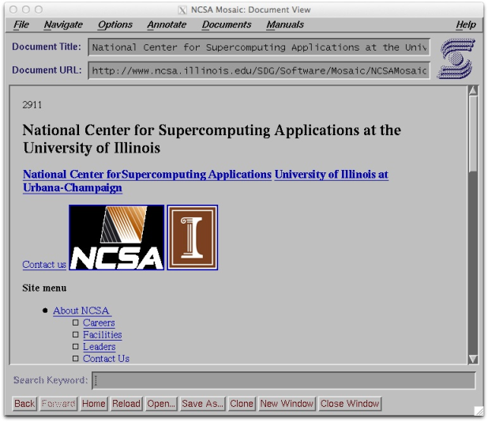
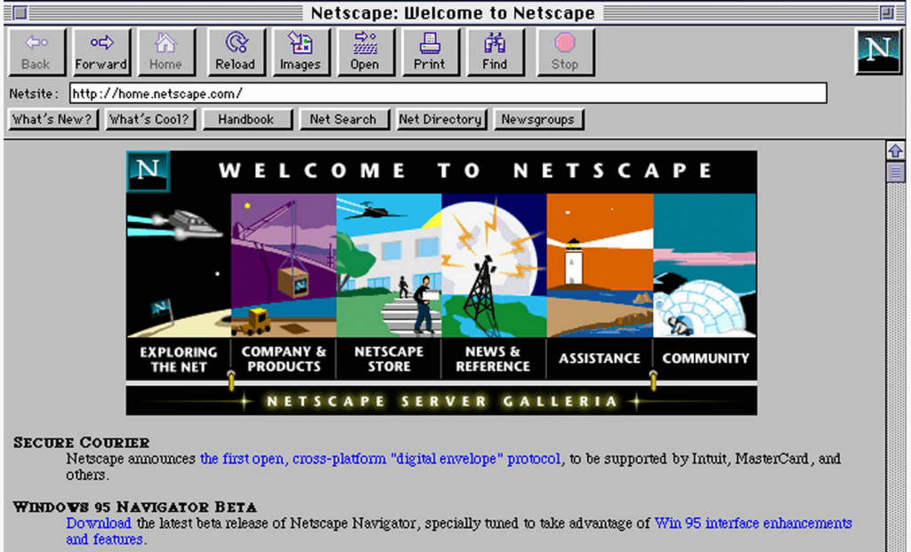
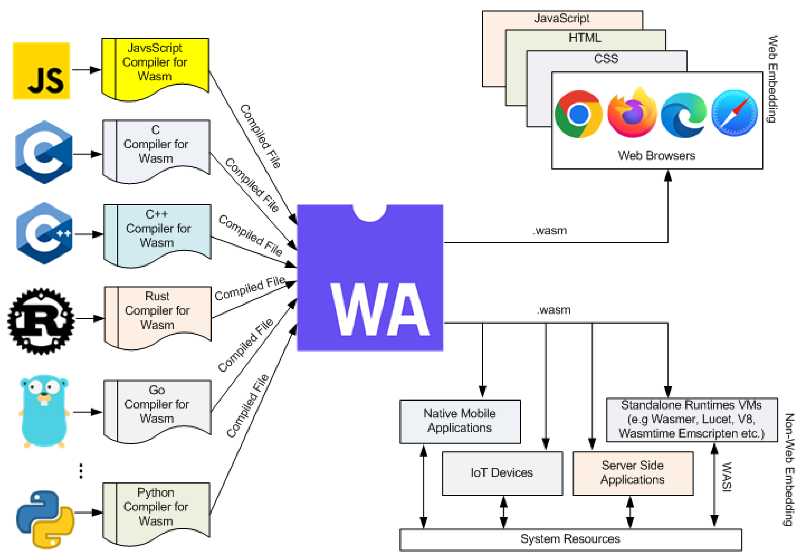
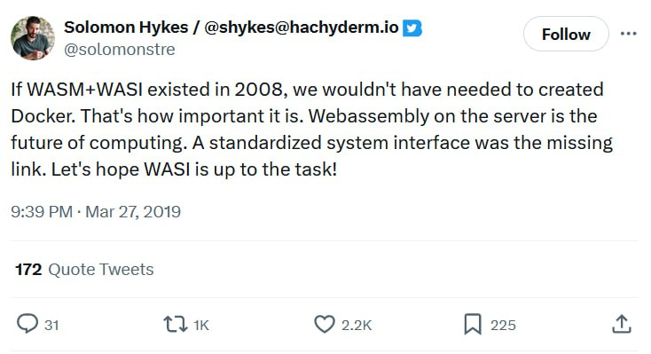
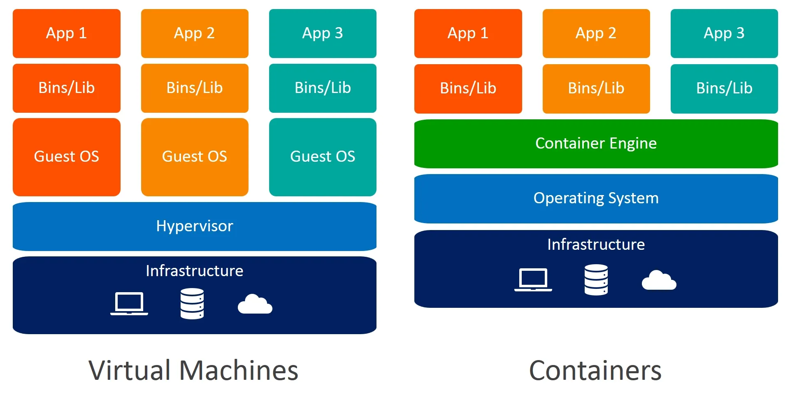
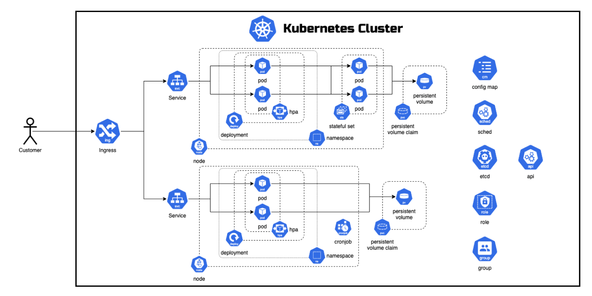
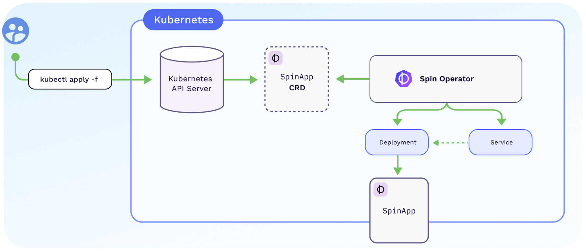
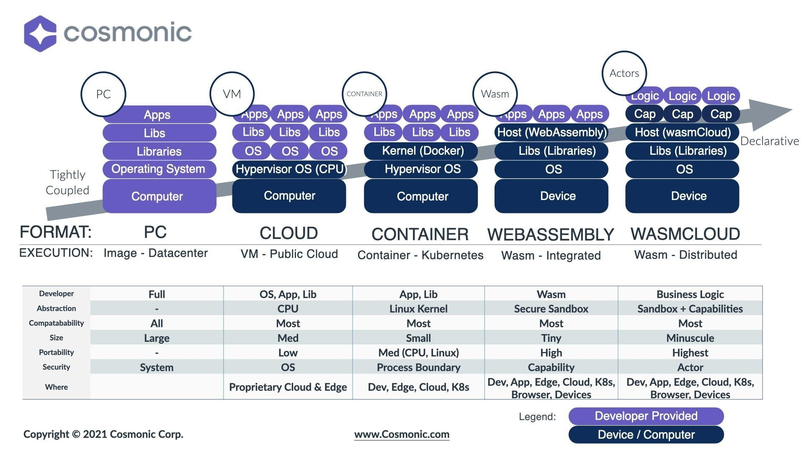
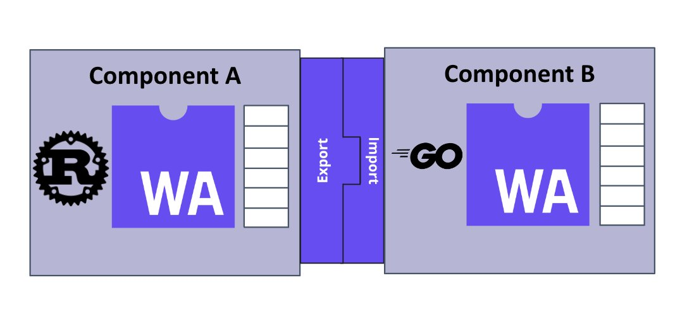

<!-- .slide: data-transition="fade" -->
## `@gdamjan`

DevOps by day

Note:
вовед, кој сум шо сум, хаклаб КИКА, НСНД
тоа е мојот nick на github, twitter, facebook, irc, matrix…

⌄⌄⌄
<!-- .slide: data-transition="fade" data-background-color="#2b2b2b" -->
## `@gdamjan`

Hacking by Night

---
## WASM

<div class="r-stack">
  <p class="fragment fade-in-then-out">WebAssembly</p>
  <p class="fragment fade-in-then-out">The future of <strike>DevOps</strike> Deployments</p>
  <p class="fragment fade-in-then-out">The Past, Present and Future of <i>wasm</i></p>
</div>

Note:
My claim: It's the future

but first! how it started

---
## Stage 1

WASM Begins

---
## The web

… is old

⌄⌄⌄


<p><small>1989</small></p>

⌄⌄⌄


<p><small>1994</small><p>

⌄⌄⌄


<p><small>1998</small></p>

---
## But then something changed…

⌄⌄⌄


<p><small>2004</small></p>

⌄⌄⌄

Gmail was one of the first, public Web Applications that didn't reload pages on user actions.

It put JavaScript on the path to become a dominant programming language.

⌄⌄⌄

The rest is history.

---

## The rise of the Web Platform


<small>(with great power comes great responsibility)</small>

Note:
as the web evolved, and we wanted more and more applications...

⌄⌄⌄
* HTML5 audio/video
* WebSockets
* WebRTC
* Web Bluetooth
* WebUSB
* WebHID
* WebSerial
* Web Workers
* WebGL/WebGPU
* WebMIDI, WebNFC, WebStorage, WebVR …

Note:
the need for speed, but also sandboxing, but also bring legacy software to the browser, and adding more features

Today, web apps are everywhere, but they need…

⌄⌄⌄
## Performance / Security / Sandboxing

---
## So what is wasm?

WebAssembly is a portable, low-level, binary-code format for executable programs

⌄⌄⌄
## How does it look like?

let's see some "hello world" examples

⌄⌄⌄
WASM in C

```gcc <magicflags> hello.c -o hello.wasm```
```
// hello.c
int factorial(int n) {
  if (n == 0)
    return 1;
  else
    return n * factorial(n-1);
}
```

⌄⌄⌄
In the browser, this is how we call that function:
```
let req = fetch("hello.wasm");
let obj = await WebAssembly.instantiateStreaming(req);
let res = obj.instance.exports.factorial(4);
console.log(res) // 24
```
⌄⌄⌄
```
20 00
42 00
51
04 7e
42 01
05
20 00
20 00
42 01
7d
10 00
7e
0b
```
(binary representation)

⌄⌄⌄
```
get_local 0
i64.const 0
i64.eq
if i64
    i64.const 1
else
    get_local 0
    get_local 0
    i64.const 1
    i64.sub
    call 0
    i64.mul
end
```
(textual representation)


⌄⌄⌄
One more
```
(module
  (import "console" "log" (func $log (param i32)))
  (func (export "logIt")
    i32.const 13
    call $log))
```

⌄⌄⌄
```
const importObject = {
  console: {
    log(arg) {
      console.log(arg);
    },
  },
};

WebAssembly.instantiateStreaming(fetch("logger.wasm"), importObject).then(
  (obj) => {
    obj.instance.exports.logIt();
  },
);
```
⌄⌄⌄
```
(module
    ;; Import the required fd_write WASI function which will write the given io vectors to stdout
    ;; The function signature for fd_write is:
    ;; (File Descriptor, *iovs, iovs_len, *nwritten) -> Returns 0 on success, nonzero on error
    (import "wasi_snapshot_preview1" "fd_write"
        (func $fd_write (param i32 i32 i32 i32) (result i32)))

    (memory 1)
    (export "memory" (memory 0))

    ;; Write 'hello world\n' to memory at an offset of 8 bytes
    ;; Note the trailing newline which is required for the text to appear
    (data (i32.const 8) "hello world\n")

    (func $main (export "_start")
        ;; Creating a new io vector within linear memory
        (i32.store (i32.const 0) (i32.const 8))  ;; iov.iov_base - This is a pointer to the start of the 'hello world\n' string
        (i32.store (i32.const 4) (i32.const 12))  ;; iov.iov_len - The length of the 'hello world\n' string

        (call $fd_write
            (i32.const 1) ;; file_descriptor - 1 for stdout
            (i32.const 0) ;; *iovs - The pointer to the iov array, which is stored at memory location 0
            (i32.const 1) ;; iovs_len - We're printing 1 string stored in an iov - so one.
            (i32.const 20) ;; nwritten - A place in memory to store the number of bytes written
        )
        drop ;; Discard the number of bytes written from the top of the stack
    )
)
```
---
## Demos
[ffmpeg in the browser](https://ffmpegwasm.netlify.app/)

⌄⌄⌄
## Demos
[Keen in the browser](http://www.jamesfmackenzie.com/chocolatekeen/)

⌄⌄⌄
## Demos
[WebAssembly.sh](https://webassembly.sh/)

⌄⌄⌄
## Demos
[Wordpress in the browser](https://wordpress.org/playground/)
[Postgres in the browser](https://pglite.dev/)

⌄⌄⌄
https://madewithwebassembly.com/

---
## The present

⌄⌄⌄


⌄⌄⌄
## The present

Rust, C, C++, Go, AssemblyScript, Grain

compile to WASM, native support

⌄⌄⌄
## The present

Python, JS, Ruby, PHP and similar

_it's complicated_

Note:
need to bundle the interpreter into the WASM binary (big)
tooling is in progress

⌄⌄⌄
## Where it is now

- All browsers
- Fastly Compute
- CloudFlare workers
- Fermyon Spin Cloud
- SpinKube (RancherDesktop too)
- WasmCloud
- Lunatic (wasm actors)
- Figma, lichess, Adobe, _etc…_

---

## Stage 2

WASM the polyglot, secure, portable backend engine

---
### Let's get back to DevOps



⌄⌄⌄



⌄⌄⌄


⌄⌄⌄

## VMs vs Docker vs WASM security

VMs see whole CPU, some virtualized hardware, high complexity

Docker/containers see whole CPU, full kernel interface, less complexity

WASM sees only exported API

Note:
Surface of attack
Surface of configuration
⌄⌄⌄

~Less~ is More

More strict is **More**

Note:
less moving parts is better

---
## Some more demos

- Spin
- wasmer, wasmtime
- Rust, WAT

⌄⌄⌄
## Sandbox revisited

Spin permissions and access

---
## The future

Keywords:
- WASI
- WASM Components
- WIT (Wasm Interface Type)

Note:
imagine kubernetes, imagine micro-services

⌄⌄⌄
## WASI Preview 2

https://github.com/WebAssembly/WASI/blob/main/wasip2/README.md

(WebAssembly System Interface)

⌄⌄⌄
WIT - Wasm Interface Type
```
interface printer {
    print: func(text: string);
}

interface error-reporter {
    report-error: func(error-message: string);
}

world multi-function-device {
    // The component implements the `printer` interface
    export printer;

    // The component implements the `scan` function
    export scan: func() -> list<u8>;

    // The component needs to be supplied with an `error-reporter`
    import error-reporter;
}
```

---
## SpinKube



⌄⌄⌄
```
apiVersion: core.spinoperator.dev/v1alpha1
kind: SpinApp
metadata:
  name: product-app
spec:
  image: "ttl.sh/coffeeshop-product-api-spin:24h"
  executor: containerd-shim-spin
  replicas: 2
```

---
## WasmCloud



⌄⌄⌄
## WasmCloud - wasm components



---
## References

- https://component-model.bytecodealliance.org/
- https://github.com/fermyon/spin
- https://github.com/lunatic-solutions/lunatic
- https://wasmtime.dev/
- wack
- wepl
- https://www.youtube.com/watch?v=JeRyh-Jj7wk
- https://github.com/wasmCloud/wasmCloud
- https://www.spinkube.dev/

---
## Q&A

---
## Challenges

- We have to throw out some assumptions about building software
- Not all the tooling is ready
- WASI is still in development
- Seems to be production ready
